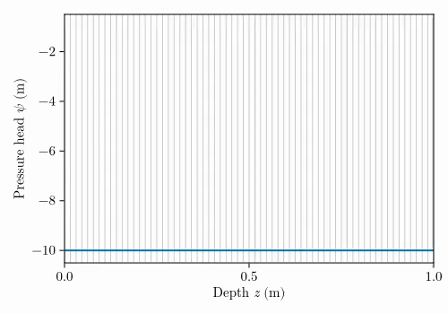

# HydroTrixi.jl

[](https://github.com/uofs-simlab/HydroTrixi.jl/actions/workflows/ci.yml)
[](https://tjbmontoya.com/HydroTrixi.jl/stable)
[](https://tjbmontoya.com/HydroTrixi.jl/dev)
[](https://github.com/uofs-simlab/HydroTrixi.jl/blob/main/LICENSE)



The Celia et al. New Mexico infiltration benchmark, using the mixed formulation with water-content solution transfer.

**HydroTrixi.jl** is an adaptive discontinuous spectral-element solver for hydrologic models based on [Trixi.jl](https://github.com/trixi-framework/Trixi.jl) [(Ranocha et al. 2022)](#references), providing the following specialized capabilities:

- Implicit temporal operator formulations using algebraic constitutive constraints or capacity functions to support mixed and pressure-head formulations of the Richards equation, respectively
- General choice of nonlinear constitutive models for soil hydraulic properties (van Genuchten-Mualem, Haverkamp, or add your own)
- Extended parabolic boundary conditions, including penalty-type Dirichlet fluxes that depend on the interior pressure head, interior flux, and prescribed boundary head
- Implicit time integration using adaptive Rosenbrock-Wanner methods with sparse graph-coloured Jacobian evaluation and forward-mode automatic differentiation
- Adaptive mesh refinement and coarsening with configurable solution-transfer variables and a total-variation-based refinement indicator for front tracking
- Solver flux output method (SFOM) diagnostics for time-integrated boundary fluxes, following [Ireson et al. (2023)](#references)
- Reusable tools to facilitate problem setup and visualization, with examples for standard hydrologic benchmark cases

The following manuscript, available as an [arXiv preprint](https://arxiv.org/abs/2610.17031), describes the methods used in HydroTrixi.jl to obtain mass-conservative solutions of the Richards equation:

```bibtex
@misc{MontoyaSpiteriAdaptiveRichards2026,
  title={A Fully Discrete, Mass-Conservative Adaptive Discontinuous
         Spectral-Element Method for the One-Dimensional {Richards}
         Equation in Mixed Form},
  author={Tristan Montoya and Raymond J. Spiteri},
  year={2026},
  eprint={2610.17031},
  archivePrefix={arXiv},
  primaryClass={math.NA},
  url={https://arxiv.org/abs/2610.17031},
}
```

Please cite this preprint if you use HydroTrixi.jl in your research. A reproducibility repository is provided [here](https://github.com/tristanmontoya/paper-2026-adaptive-richards).

## Installation

If you have not yet installed Julia, please [follow the instructions for your operating system](https://julialang.org/downloads/platform/). HydroTrixi.jl works with Julia v1.10 and newer. We recommend using the latest stable release.

Install and run HydroTrixi.jl from a local clone:

```bash
git clone https://github.com/uofs-simlab/HydroTrixi.jl.git
cd HydroTrixi.jl
julia --project=.
```

Then instantiate dependencies in the Julia REPL:

```julia
julia> using Pkg

julia> Pkg.instantiate()
```

Run the test suite:

```julia
julia> Pkg.test()
```

Worked examples and tutorials are provided in the [documentation](https://tjbmontoya.com/HydroTrixi.jl/stable).

## References

- Ranocha, H., Schlottke-Lakemper, M., Winters, A. R., Faulhaber, E., Chan, J., and Gassner, G. J. (2022). [Adaptive numerical simulations with Trixi.jl: A case study of Julia for scientific computing](https://doi.org/10.21105/jcon.00077). _Proceedings of the JuliaCon Conferences_, 1(1), 77.
- Ireson, A. M., Spiteri, R. J., Clark, M. P., and Mathias, S. A. (2023). [A simple, efficient, mass-conservative approach to solving the Richards equation (openRE, v1.0)](https://doi.org/10.5194/gmd-16-659-2023). _Geoscientific Model Development_, 16, 659-677.
- Montoya, T., and Spiteri, R. J. (2026). [A fully discrete, mass-conservative adaptive discontinuous spectral-element method for the one-dimensional Richards equation in mixed form](https://arxiv.org/abs/2610.17031). arXiv:2610.17031 [math.NA].

## Acknowledgements

The developers of this package acknowledge funding support from the [Cooperative Institute for Research to Operations in Hydrology (CIROH)](https://ciroh.ua.edu/) and the [Natural Sciences and Engineering Research Council of Canada (NSERC)](https://www.nserc-crsng.gc.ca/).

## License

HydroTrixi.jl is released under the [MIT License](https://github.com/uofs-simlab/HydroTrixi.jl/blob/main/LICENSE).
